# Hey there! 👋

I'm a software developer diving deep into JavaScript, PHP, C#, and C. I also dabble in a few other languages like Ruby, Crystal, Java, and Python.

On top of coding, I have a solid background in web design. I love using frameworks and tools like NextJs (react), Nuxt (vue), Adonis JS, Angular, Laravel and a bunch of other libraries to build cool websites.

I'm all about creating fun and functional applications, and I'm always looking to learn new things in this ever-changing tech world!

---

---

<!--
**Venipa/Venipa** is a ✨ _special_ ✨ repository because its `README.md` (this file) appears on your GitHub profile.

Here are some ideas to get you started:

- 🔭 I’m currently working on ...
- 🌱 I’m currently learning ...
- 👯 I’m looking to collaborate on ...
- 🤔 I’m looking for help with ...
- 💬 Ask me about ...
- 📫 How to reach me: ...
- 😄 Pronouns: ...
- ⚡ Fun fact: ...
-->
